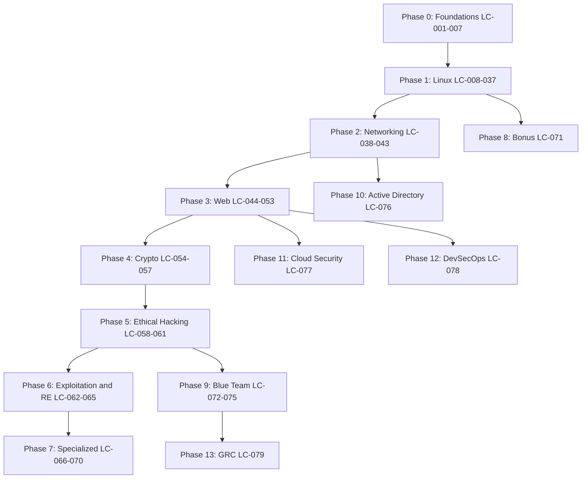

**Language:** [English](ROADMAP.md) | [Bahasa Indonesia](ROADMAP.id.md) | [日本語](ROADMAP.ja.md)

# Zero2Root: Master Roadmap

> 79 lessons across 14 phases, each written independently in Bahasa Indonesia, English, and Japanese.
> Books: `~/Documents/Books/`, see [BOOKS.md](BOOKS.md) for the full catalog.
> This page is the English edition and links only to the English lesson files.
> Author: [kodoktheGr3at](https://github.com/Kodokthegr3at/) | 2026

---

## How to use this roadmap

0. Not sure where you are heading? Pick a role in [CAREERS.md](CAREERS.md) first. It tells you which of these lessons to take and in what order.
1. Follow the order `LC-001` through `LC-079` unless you have already mastered a phase.
2. Each lesson file carries a Curriculum ID block near the top (search for `LC-CURRICULUM`).
3. Read the book map line, then open the referenced chapters from [BOOKS.md](BOOKS.md).
4. Work through the security notes and cheatsheet sections hands-on in a lab VM.
5. Estimated total time for full mastery: roughly 325 to 405 hours.

---

## Phase 0: Foundations & Computing Basics (`LC-001-007`)

Category: **Foundation**

Primary books: Friedl, Gray Hat Hacking, K. N. King, Shotts, Sweigart, Ward.

| ID | Topic | Level | Hours | Prerequisites |
|:---|:------|:------|:------|:---------------|
| `LC-001` | [Expression](basics/en/Expression.md) | Beginner | 2-3h | - |
| `LC-002` | [Git — Version Control System](basics/en/Git%20%E2%80%94%20Version%20Control%20System.md) | Beginner | 3-4h | LC-001 |
| `LC-003` | [PowerShell](basics/en/PowerShell.md) | Beginner | 4-5h | LC-001 |
| `LC-004` | [Windows Command Prompt (cmd.exe)](basics/en/Windows%20Command%20Prompt%20%28cmd.exe%29.md) | Beginner | 3-4h | LC-001 |
| `LC-005` | [Linux File System](basics/OperatingSystem/en/Linux%20File%20System.md) | Beginner | 5-6h | LC-001 |
| `LC-006` | [Windows File System](basics/OperatingSystem/en/Windows%20File%20System.md) | Beginner | 5-6h | LC-001 |
| `LC-007` | [macOS File System](basics/OperatingSystem/en/macOS%20File%20System.md) | Beginner | 4-5h | LC-001 |

**Book map detail for this phase**

| ID | Book chapters |
|:---|:---------------|
| `LC-001` | K. N. King, C Programming Ch.2-5; Friedl, Mastering Regular Expressions Ch.1-4; Sweigart, Automate the Boring Stuff Ch.1-6 |
| `LC-002` | Shotts, The Linux Command Line Ch.17-18 (VCS concepts) |
| `LC-003` | Gray Hat Hacking, Windows post-exploitation chapters |
| `LC-004` | Gray Hat Hacking, Windows enumeration |
| `LC-005` | Ward, How Linux Works Ch.3-5 (FHS, /proc, /sys); Shotts, The Linux Command Line Ch.3 |
| `LC-006` | Gray Hat Hacking, NTFS, Registry, ADS |
| `LC-007` | Ward, How Linux Works (Unix comparison); Apple platform guides |

---

## Phase 1: Linux Fundamentals & Administration (`LC-008-037`)

Category: **Foundation**

Primary books: Benvenuti, Friedl, Kurose & Ross, NIST SP 800-190 (container security), Oracle Solaris 11 Admin Docs, Shotts, Stallings, Stevens, Stuttard, Ward.

| ID | Topic | Level | Hours | Prerequisites |
|:---|:------|:------|:------|:---------------|
| `LC-008` | [Linux Structure — History, Philosophy, Architecture & Filesystem](linux/en/01.%20Linux%20Structure%20%E2%80%94%20History%2C%20Philosophy%2C%20Architecture%20%26%20Filesystem.md) | Beginner | 3-4h | LC-005 |
| `LC-009` | [Linux Distributions (Distros)](linux/en/02.%20Linux%20Distributions%20%28Distros%29.md) | Beginner | 2-3h | LC-008 |
| `LC-010` | [Introduction to Shell](linux/en/03.%20Introduction%20to%20Shell.md) | Beginner | 4-5h | LC-008 |
| `LC-011` | [Prompt Description & PS1 Customization](linux/en/04.%20Prompt%20Description%20%26%20PS1%20Customization.md) | Beginner | 2h | LC-010 |
| `LC-012` | [Getting Help — man, --help, apropos](linux/en/05.%20Getting%20Help%20%E2%80%94%20man%2C%20--help%2C%20apropos.md) | Beginner | 2h | LC-010 |
| `LC-013` | [System Information — Kernel, Hardware & Environment](linux/en/06.%20System%20Information%20%E2%80%94%20Kernel%2C%20Hardware%20%26%20Environment.md) | Beginner | 3h | LC-010 |
| `LC-014` | [Navigation — Moving Through the Linux Filesystem](linux/en/07.%20Navigation%20%E2%80%94%20Moving%20Through%20the%20Linux%20Filesystem.md) | Beginner | 2-3h | LC-010 |
| `LC-015` | [Working with Files & Directories](linux/en/08.%20Working%20with%20Files%20%26%20Directories.md) | Beginner | 3-4h | LC-014 |
| `LC-016` | [Editing Files — Nano & Vim](linux/en/09.%20Editing%20Files%20%E2%80%94%20Nano%20%26%20Vim.md) | Beginner | 4-5h | LC-014 |
| `LC-017` | [Find Files & Directories](linux/en/10.%20Find%20Files%20%26%20Directories.md) | Beginner | 3h | LC-015 |
| `LC-018` | [File Descriptors & Redirections](linux/en/11.%20File%20Descriptors%20%26%20Redirections.md) | Intermediate | 4h | LC-010 |
| `LC-019` | [Filter Contents — Output Filtering & Text Processing](linux/en/12.%20Filter%20Contents%20%E2%80%94%20Output%20Filtering%20%26%20Text%20Processing.md) | Intermediate | 4-5h | LC-018 |
| `LC-020` | [Regular Expressions (RegEx)](linux/en/13.%20Regular%20Expressions%20%28RegEx%29.md) | Intermediate | 5-6h | LC-019 |
| `LC-021` | [Permission Management](linux/en/14.%20Permission%20Management.md) | Intermediate | 4-5h | LC-015 |
| `LC-022` | [User Management](linux/en/15.%20User%20Management.md) | Intermediate | 4h | LC-021 |
| `LC-023` | [Package Management](linux/en/16.%20Package%20Management.md) | Intermediate | 3-4h | LC-009 |
| `LC-024` | [Service and Process Management](linux/en/17.%20Service%20and%20Process%20Management.md) | Intermediate | 4-5h | LC-022 |
| `LC-025` | [Task Scheduling](linux/en/18.%20Task%20Scheduling.md) | Intermediate | 3-4h | LC-024 |
| `LC-026` | [Network Services](linux/en/19.%20Network%20Services.md) | Intermediate | 4h | LC-024, LC-038 |
| `LC-027` | [Working with Web Services](linux/en/20.%20Working%20with%20Web%20Services.md) | Intermediate | 3-4h | LC-024 |
| `LC-028` | [Backup and Restore](linux/en/21.%20Backup%20and%20Restore.md) | Intermediate | 3h | LC-015 |
| `LC-029` | [File System Management](linux/en/22.%20File%20System%20Management.md) | Intermediate | 4-5h | LC-015 |
| `LC-030` | [Containerization](linux/en/23.%20Containerization.md) | Advanced | 4-5h | LC-024, LC-021 |
| `LC-031` | [Linux Networking — Interfaces & Routing](linux/en/24.%20Linux%20Networking%20%E2%80%94%20Interfaces%20%26%20Routing.md) | Intermediate | 4h | LC-038, LC-039 |
| `LC-032` | [Linux Networking — Diagnostics & Packet Analysis](linux/en/25.%20Linux%20Networking%20%E2%80%94%20Diagnostics%20%26%20Packet%20Analysis.md) | Intermediate | 4-5h | LC-031 |
| `LC-033` | [Linux Security — Threat Model & Hardening Theory](linux/en/26.%20Linux%20Security%20%E2%80%94%20Threat%20Model%20%26%20Hardening%20Theory.md) | Advanced | 4h | LC-021, LC-024 |
| `LC-034` | [Firewall Setup](linux/en/27.%20Firewall%20Setup.md) | Advanced | 4h | LC-033, LC-031 |
| `LC-035` | [System Logs](linux/en/28.%20System%20Logs.md) | Intermediate | 3-4h | LC-024 |
| `LC-036` | [Solaris — Linux Distributions vs Solaris](linux/en/29.%20Solaris%20%E2%80%94%20Linux%20Distributions%20vs%20Solaris.md) | Intermediate | 2-3h | LC-008, LC-024 |
| `LC-037` | [Shortcuts — Bash Tips & Tricks](linux/en/30.%20Shortcuts%20%E2%80%94%20Bash%20Tips%20%26%20Tricks.md) | Intermediate | 6-8h | LC-010-LC-020 |

**Book map detail for this phase**

| ID | Book chapters |
|:---|:---------------|
| `LC-008` | Ward, How Linux Works Ch.1-2; Shotts, The Linux Command Line Ch.1-2 |
| `LC-009` | Ward, How Linux Works Ch.1; Shotts, The Linux Command Line Ch.1 |
| `LC-010` | Shotts, The Linux Command Line Ch.4-6, 18; Ward, How Linux Works Ch.7 |
| `LC-011` | Shotts, The Linux Command Line Ch.6 (Prompt); Ward, How Linux Works Ch.7 |
| `LC-012` | Shotts, The Linux Command Line Ch.7; Ward, How Linux Works Ch.1 |
| `LC-013` | Ward, How Linux Works Ch.2-3, 6; Shotts, The Linux Command Line Ch.15 |
| `LC-014` | Shotts, The Linux Command Line Ch.3-4; Ward, How Linux Works Ch.3 |
| `LC-015` | Shotts, The Linux Command Line Ch.8-10; Ward, How Linux Works Ch.4 |
| `LC-016` | Shotts, The Linux Command Line Ch.11-12, 24 |
| `LC-017` | Shotts, The Linux Command Line Ch.17; Ward, How Linux Works Ch.4 |
| `LC-018` | Shotts, The Linux Command Line Ch.6, 19; Stevens, UNIX Network Programming Vol.1 Ch.3-4 |
| `LC-019` | Shotts, The Linux Command Line Ch.16, 20-21; Ward, How Linux Works Ch.7 |
| `LC-020` | Friedl, Mastering Regular Expressions (full); Shotts, The Linux Command Line Ch.20 |
| `LC-021` | Ward, How Linux Works Ch.4; Shotts, The Linux Command Line Ch.10; Stallings, Network Security Essentials Ch.4 |
| `LC-022` | Ward, How Linux Works Ch.5; Shotts, The Linux Command Line Ch.10 |
| `LC-023` | Ward, How Linux Works Ch.1, 15; Shotts, The Linux Command Line Ch.13 |
| `LC-024` | Ward, How Linux Works Ch.6-7; Shotts, The Linux Command Line Ch.14-15 |
| `LC-025` | Ward, How Linux Works Ch.7; Shotts, The Linux Command Line Ch.14 |
| `LC-026` | Benvenuti, Understanding Linux Network Internals Ch.9-12; Stevens, UNIX Network Programming Vol.1 Ch.9-11 |
| `LC-027` | Ward, How Linux Works Ch.8; Stuttard, WAHH Ch.1 |
| `LC-028` | Ward, How Linux Works Ch.4; Shotts, The Linux Command Line Ch.17 |
| `LC-029` | Ward, How Linux Works Ch.4; Shotts, The Linux Command Line Ch.17 |
| `LC-030` | Ward, How Linux Works Ch.6; NIST SP 800-190 (container security) |
| `LC-031` | Benvenuti, Understanding Linux Network Internals Ch.14-19; Stevens, UNIX Network Programming Vol.1 Ch.3, 16-17 |
| `LC-032` | Benvenuti, Understanding Linux Network Internals Ch.20-26; Kurose & Ross, Computer Networking Ch.1 |
| `LC-033` | Stallings, Network Security Essentials Ch.4-5, 9; Ward, How Linux Works Ch.5, 8 |
| `LC-034` | Stallings, Network Security Essentials Ch.9 (Firewalls); Benvenuti, Linux Network Internals Ch.26 |
| `LC-035` | Ward, How Linux Works Ch.7; Shotts, The Linux Command Line Ch.15 |
| `LC-036` | Ward, How Linux Works (Unix lineage); Oracle Solaris 11 Admin Docs |
| `LC-037` | Shotts, The Linux Command Line (full reference); Friedl, Mastering Regular Expressions |

---

## Phase 2: Computer Networking & Protocols (`LC-038-043`)

Category: **Foundation**

Primary books: Gast, Kurose & Ross, Stallings, Stevens.

| ID | Topic | Level | Hours | Prerequisites |
|:---|:------|:------|:------|:---------------|
| `LC-038` | [OSI Modelling](networking/en/OSI%20Modelling.md) | Beginner | 6-8h | LC-005 |
| `LC-039` | [TCP-IP Architecture & Socket Programming](networking/en/TCP-IP%20Architecture%20%26%20Socket%20Programming.md) | Intermediate | 5-6h | LC-038 |
| `LC-040` | [IP Addressing & Subnetting](networking/en/IP%20Addressing%20%26%20Subnetting.md) | Intermediate | 4-5h | LC-038 |
| `LC-041` | [DNS & Domain Name System Security](networking/en/DNS%20%26%20Domain%20Name%20System%20Security.md) | Intermediate | 4h | LC-039 |
| `LC-042` | [ARP & Local Network Attacks](networking/en/ARP%20%26%20Local%20Network%20Attacks.md) | Advanced | 4h | LC-039, LC-040 |
| `LC-043` | [Wireless 802.11 Security & Attacks](networking/en/Wireless%20802.11%20Security%20%26%20Attacks.md) | Advanced | 5h | LC-038 |

**Book map detail for this phase**

| ID | Book chapters |
|:---|:---------------|
| `LC-038` | Kurose & Ross, Computer Networking Ch.1-2; Stallings, Network Security Essentials Ch.2 |
| `LC-039` | Kurose & Ross, Computer Networking Ch.3-4; Stevens, UNIX Network Programming Vol.1 Ch.1-6 |
| `LC-040` | Kurose & Ross, Computer Networking Ch.4; Stallings, Network Security Essentials Ch.2 |
| `LC-041` | Kurose & Ross, Computer Networking Ch.2; Stallings, Network Security Essentials Ch.8 |
| `LC-042` | Kurose & Ross, Computer Networking Ch.4-5; Stallings, Network Security Essentials Ch.8 |
| `LC-043` | Gast, 802.11 Wireless Networks (full); Stallings, Network Security Essentials Ch.8 |

---

## Phase 3: Web Protocols & Application Security (`LC-044-053`)

Category: **Offensive (red team)**

Primary books: Kurose & Ross, Stuttard, Wong, Zalewski.

| ID | Topic | Level | Hours | Prerequisites |
|:---|:------|:------|:------|:---------------|
| `LC-044` | [HTTP & cURL](web/HTTP/en/1.%20HTTP%20%26%20cURL.md) | Beginner | 3h | LC-038, LC-039 |
| `LC-045` | [HTTP Requests, Responses & Status Codes](web/HTTP/en/2.%20HTTP%20Requests%2C%20Responses%20%26%20Status%20Codes.md) | Beginner | 3h | LC-044 |
| `LC-046` | [HTTP Headers & Security Headers](web/HTTP/en/3.%20HTTP%20Headers%20%26%20Security%20Headers.md) | Intermediate | 3-4h | LC-045 |
| `LC-047` | [SQL Injection (SQLi)](web/Vulnerabilities/en/1.%20SQL%20Injection%20%28SQLi%29.md) | Intermediate | 5-6h | LC-044-LC-046 |
| `LC-048` | [Cross-Site Scripting (XSS)](web/Vulnerabilities/en/2.%20Cross-Site%20Scripting%20%28XSS%29.md) | Intermediate | 4-5h | LC-046 |
| `LC-049` | [Cross-Site Request Forgery (CSRF)](web/Vulnerabilities/en/3.%20Cross-Site%20Request%20Forgery%20%28CSRF%29.md) | Intermediate | 3h | LC-046 |
| `LC-050` | [Server-Side Request Forgery (SSRF)](web/Vulnerabilities/en/4.%20Server-Side%20Request%20Forgery%20%28SSRF%29.md) | Advanced | 3-4h | LC-046 |
| `LC-051` | [Command Injection & File Inclusion (LFI & RFI)](web/Vulnerabilities/en/5.%20Command%20Injection%20%26%20File%20Inclusion%20%28LFI%20%26%20RFI%29.md) | Advanced | 4-5h | LC-047 |
| `LC-052` | [File Upload Vulnerabilities & Web Shells](web/Vulnerabilities/en/6.%20File%20Upload%20Vulnerabilities%20%26%20Web%20Shells.md) | Advanced | 3-4h | LC-047 |
| `LC-053` | [Authentication, Session & JWT Attacks](web/Vulnerabilities/en/7.%20Authentication%2C%20Session%20%26%20JWT%20Attacks.md) | Advanced | 4-5h | LC-046, LC-054 |

**Book map detail for this phase**

| ID | Book chapters |
|:---|:---------------|
| `LC-044` | Kurose & Ross, Computer Networking Ch.2; Stuttard, WAHH Ch.1; Zalewski, The Tangled Web Ch.1-3 |
| `LC-045` | Stuttard, WAHH Ch.1-3; Zalewski, The Tangled Web Ch.3-5 |
| `LC-046` | Stuttard, WAHH Ch.4; Zalewski, The Tangled Web Ch.9-11 |
| `LC-047` | Stuttard, WAHH Ch.9; Zalewski, The Tangled Web Ch.12 |
| `LC-048` | Stuttard, WAHH Ch.12; Zalewski, The Tangled Web Ch.6-8 |
| `LC-049` | Stuttard, WAHH Ch.13; Zalewski, The Tangled Web Ch.9 |
| `LC-050` | Stuttard, WAHH Ch.10; Zalewski, The Tangled Web Ch.11 |
| `LC-051` | Stuttard, WAHH Ch.10-11; Zalewski, The Tangled Web Ch.12 |
| `LC-052` | Stuttard, WAHH Ch.10; Zalewski, The Tangled Web Ch.13 |
| `LC-053` | Stuttard, WAHH Ch.6-7; Zalewski, The Tangled Web Ch.9-10; Wong, Real-World Cryptography Ch.8-10 |

---

## Phase 4: Cryptography & Transport Security (`LC-054-057`)

Category: **Foundation**

Primary books: Stallings, Wong.

| ID | Topic | Level | Hours | Prerequisites |
|:---|:------|:------|:------|:---------------|
| `LC-054` | [Symmetric Cryptography & Block Ciphers](cryptography/en/1.%20Symmetric%20Cryptography%20%26%20Block%20Ciphers.md) | Intermediate | 4-5h | LC-001 |
| `LC-055` | [Asymmetric Cryptography & Key Exchange](cryptography/en/2.%20Asymmetric%20Cryptography%20%26%20Key%20Exchange.md) | Intermediate | 4-5h | LC-054 |
| `LC-056` | [Hash Functions & Message Authentication](cryptography/en/3.%20Hash%20Functions%20%26%20Message%20Authentication.md) | Intermediate | 3-4h | LC-054 |
| `LC-057` | [Public Key Infrastructure (PKI) & TLS 1.3](cryptography/en/4.%20Public%20Key%20Infrastructure%20%28PKI%29%20%26%20TLS%201.3.md) | Advanced | 5h | LC-055, LC-056 |

**Book map detail for this phase**

| ID | Book chapters |
|:---|:---------------|
| `LC-054` | Wong, Real-World Cryptography Ch.1-4; Stallings, Network Security Essentials Ch.3-4 |
| `LC-055` | Wong, Real-World Cryptography Ch.5-9; Stallings, Network Security Essentials Ch.3 |
| `LC-056` | Wong, Real-World Cryptography Ch.2, 10-11; Stallings, Network Security Essentials Ch.3 |
| `LC-057` | Wong, Real-World Cryptography Ch.12-15; Stallings, Network Security Essentials Ch.5-6 |

---

## Phase 5: Ethical Hacking & Penetration Testing (`LC-058-061`)

Category: **Offensive (red team)**

Primary books: Gray Hat Hacking, Gray Hat Hacking Part I, Kennedy et al., Kim, Weidman.

| ID | Topic | Level | Hours | Prerequisites |
|:---|:------|:------|:------|:---------------|
| `LC-058` | [Penetration Testing Methodology & Reconnaissance](ethical-hacking/en/1.%20Penetration%20Testing%20Methodology%20%26%20Reconnaissance.md) | Intermediate | 4-5h | LC-038, LC-044 |
| `LC-059` | [Port Scanning & Network Enumeration (Nmap)](ethical-hacking/en/2.%20Port%20Scanning%20%26%20Network%20Enumeration%20%28Nmap%29.md) | Intermediate | 4h | LC-058, LC-039 |
| `LC-060` | [Metasploit Framework & Exploitation](ethical-hacking/en/3.%20Metasploit%20Framework%20%26%20Exploitation.md) | Advanced | 5-6h | LC-059 |
| `LC-061` | [Privilege Escalation & Post-Exploitation](ethical-hacking/en/4.%20Privilege%20Escalation%20%26%20Post-Exploitation.md) | Advanced | 5-6h | LC-021, LC-060 |

**Book map detail for this phase**

| ID | Book chapters |
|:---|:---------------|
| `LC-058` | Kim, The Hacker Playbook 3 Ch.1-2; Weidman, Penetration Testing Ch.1-4; Gray Hat Hacking Part I |
| `LC-059` | Kim, The Hacker Playbook 3 Ch.2; Weidman, Penetration Testing Ch.5-6 |
| `LC-060` | Kennedy et al., Metasploit: The Penetration Tester's Guide; Kim, The Hacker Playbook 3 Ch.3-5 |
| `LC-061` | Kim, The Hacker Playbook 3 Ch.6-8; Gray Hat Hacking, PrivEsc chapters; Weidman, Penetration Testing Ch.8-10 |

---

## Phase 6: Binary Exploitation & Malware Analysis (`LC-062-065`)

Category: **Exploitation & reverse engineering**

Primary books: Andriesse, Anley et al., Dang et al., Erickson, Gray Hat Hacking, King, Sikorski & Honig.

| ID | Topic | Level | Hours | Prerequisites |
|:---|:------|:------|:------|:---------------|
| `LC-062` | [Stack Buffer Overflow & Shellcoding](binary-exploitation/en/Stack%20Buffer%20Overflow%20%26%20Shellcoding.md) | Advanced | 6-8h | LC-001, LC-065 |
| `LC-063` | [Static Malware Analysis Fundamentals](malware-analysis/en/1.%20Static%20Malware%20Analysis%20Fundamentals.md) | Advanced | 5-6h | LC-005, LC-038 |
| `LC-064` | [Dynamic Malware Analysis & Sandboxing](malware-analysis/en/2.%20Dynamic%20Malware%20Analysis%20%26%20Sandboxing.md) | Advanced | 5h | LC-063 |
| `LC-065` | [x86 & x64 Assembly for Reverse Engineering](malware-analysis/en/3.%20x86%20%26%20x64%20Assembly%20for%20Reverse%20Engineering.md) | Advanced | 8-10h | LC-001 |

**Book map detail for this phase**

| ID | Book chapters |
|:---|:---------------|
| `LC-062` | Anley et al., The Shellcoder's Handbook; Erickson, Hacking: The Art of Exploitation; Gray Hat Hacking, Exploitation |
| `LC-063` | Sikorski & Honig, Practical Malware Analysis Part I-II; Andriesse, Practical Binary Analysis Ch.1-4 |
| `LC-064` | Sikorski & Honig, Practical Malware Analysis Part III-IV; Andriesse, Practical Binary Analysis Ch.5-7 |
| `LC-065` | Dang et al., Practical Reverse Engineering; Sikorski & Honig, PMA Appendix; King, C Programming (memory model) |

---

## Phase 7: Specialized Security Domains (`LC-066-070`)

Category: **Specialized domains**

Primary books: Akhgar et al., Chantzis et al., Elenkov, Gray, Gupta, Hadnagy, Mitnick, Seitz & Arnold, Smith, Steele et al., Stevens, van Woudenberg & O'Flynn.

| ID | Topic | Level | Hours | Prerequisites |
|:---|:------|:------|:------|:---------------|
| `LC-066` | [Android Security Internals & Vulnerabilities](mobile-security/en/Android%20Security%20Internals%20%26%20Vulnerabilities.md) | Advanced | 6-8h | LC-054, LC-047 |
| `LC-067` | [Offensive Python & Go for Pentesters](programming-security/en/Offensive%20Python%20%26%20Go%20for%20Pentesters.md) | Advanced | 6-8h | LC-001, LC-018 |
| `LC-068` | [Social Engineering — Principles, Vectors & Defense](social-engineering/en/Social%20Engineering%20%E2%80%94%20Principles%2C%20Vectors%20%26%20Defense.md) | Intermediate | 4-5h | LC-058 |
| `LC-069` | [OSINT — Open Source Intelligence Framework & Techniques](osint/en/OSINT%20%E2%80%94%20Open%20Source%20Intelligence%20Framework%20%26%20Techniques.md) | Intermediate | 5h | LC-058 |
| `LC-070` | [Hardware & IoT Security — Interfaces, Firmware & Automotive](hardware-iot/en/Hardware%20%26%20IoT%20Security%20%E2%80%94%20Interfaces%2C%20Firmware%20%26%20Automotive.md) | Advanced | 6-8h | LC-038 |

**Book map detail for this phase**

| ID | Book chapters |
|:---|:---------------|
| `LC-066` | Elenkov, Android Security Internals (full) |
| `LC-067` | Seitz & Arnold, Black Hat Python 2nd Ed.; Steele et al., Black Hat Go; Stevens, UNIX Network Programming Vol.1 |
| `LC-068` | Hadnagy, Social Engineering 2nd Ed.; Mitnick, The Art of Deception; Gray, Practical Social Engineering |
| `LC-069` | Akhgar et al., Open Source Intelligence Methods and Tools |
| `LC-070` | van Woudenberg & O'Flynn, The Hardware Hacking Handbook; Chantzis et al., Practical IoT Hacking; Smith, The Car Hacker's Handbook; Gupta, The IoT Hacker's Handbook |

---

## Phase 8: Bonus & Productivity (`LC-071`)

Category: **Bonus**

Primary books: Shotts.

| ID | Topic | Level | Hours | Prerequisites |
|:---|:------|:------|:------|:---------------|
| `LC-071` | [Neovim — Tips & Tricks](linux/Tips%20%26%20Tricks/en/Neovim%20%E2%80%94%20Tips%20%26%20Tricks.md) | Intermediate | 8-10h | LC-016 |

**Book map detail for this phase**

| ID | Book chapters |
|:---|:---------------|
| `LC-071` | Shotts, The Linux Command Line Ch.11-12, 24 |

---

## Phase 9: Blue Team & Defensive Security (`LC-072-075`)

Category: **Defensive (blue team)**

Primary books: Bejtlich, Carrier, Kurose & Ross, Ligh et al., NIST SP 800-61r2 / 800-86, Sanders, Sikorski & Honig, Stallings.

| ID | Topic | Level | Hours | Prerequisites |
|:---|:------|:------|:------|:---------------|
| `LC-072` | [SOC & Log Analysis](blue-team/en/1.%20SOC%20%26%20Log%20Analysis.md) | Beginner | 5-6h | LC-035, LC-038 |
| `LC-073` | [Network Security Monitoring (Wireshark, Zeek, Suricata)](blue-team/en/2.%20Network%20Security%20Monitoring%20%28Wireshark%2C%20Zeek%2C%20Suricata%29.md) | Intermediate | 6-7h | LC-032, LC-039, LC-072 |
| `LC-074` | [Threat Hunting & Detection Engineering (Sigma, YARA, ATT&CK)](blue-team/en/3.%20Threat%20Hunting%20%26%20Detection%20Engineering%20%28Sigma%2C%20YARA%2C%20ATT%26CK%29.md) | Advanced | 6-8h | LC-063, LC-072, LC-073 |
| `LC-075` | [Incident Response & Digital Forensics](blue-team/en/4.%20Incident%20Response%20%26%20Digital%20Forensics.md) | Advanced | 7-9h | LC-006, LC-064, LC-072, LC-074 |

**Book map detail for this phase**

| ID | Book chapters |
|:---|:---------------|
| `LC-072` | Stallings, Network Security Essentials Ch.9; NIST SP 800-61r2 (Incident Handling Guide) |
| `LC-073` | Bejtlich, The Practice of Network Security Monitoring; Sanders, Practical Packet Analysis; Kurose & Ross, Computer Networking Ch.1-3 |
| `LC-074` | MITRE ATT&CK Enterprise Matrix; Sigma Specification; YARA Documentation; Sikorski & Honig, Practical Malware Analysis Ch.1-3 |
| `LC-075` | NIST SP 800-61r2; NIST SP 800-86 (Forensic Techniques); Carrier, File System Forensic Analysis; Ligh et al., The Art of Memory Forensics |

---

## Phase 10: Active Directory Security (`LC-076`)

Category: **Specialized domains**

Primary books: Desmond et al., Microsoft Learn.

| ID | Topic | Level | Hours | Prerequisites |
|:---|:------|:------|:------|:---------------|
| `LC-076` | [Active Directory Fundamentals](active-directory/en/1.%20Active%20Directory%20Fundamentals.md) | Intermediate | 5-6h | LC-006, LC-026, LC-041 |

**Book map detail for this phase**

| ID | Book chapters |
|:---|:---------------|
| `LC-076` | Desmond et al., Active Directory 5th Ed. Ch.1-4; Microsoft Learn, AD DS Overview |

---

## Phase 11: Cloud Security (`LC-077`)

Category: **Specialized domains**

Primary books: Dotson, AWS Well-Architected Framework, CIS Benchmarks.

| ID | Topic | Level | Hours | Prerequisites |
|:---|:------|:------|:------|:---------------|
| `LC-077` | [Cloud Security Fundamentals](cloud-security/en/1.%20Cloud%20Security%20Fundamentals.md) | Intermediate | 5-6h | LC-030, LC-040, LC-050 |

**Book map detail for this phase**

| ID | Book chapters |
|:---|:---------------|
| `LC-077` | Dotson, Practical Cloud Security 2nd Ed. Ch.1-5; AWS Well-Architected Framework, Security Pillar; CIS AWS Foundations Benchmark |

---

## Phase 12: DevSecOps (`LC-078`)

Category: **Specialized domains**

Primary books: Kim et al., Shostack, OWASP DevSecOps Guideline.

| ID | Topic | Level | Hours | Prerequisites |
|:---|:------|:------|:------|:---------------|
| `LC-078` | [DevSecOps Fundamentals](devsecops/en/1.%20DevSecOps%20Fundamentals.md) | Intermediate | 6-7h | LC-002, LC-030, LC-053 |

**Book map detail for this phase**

| ID | Book chapters |
|:---|:---------------|
| `LC-078` | Kim et al., The DevOps Handbook 2nd Ed. Ch.22-23; Shostack, Threat Modeling Ch.1-3; OWASP DevSecOps Guideline |

---

## Phase 13: Governance, Risk & Compliance (`LC-079`)

Category: **Specialized domains**

Primary books: Hubbard & Seiersen, ISO/IEC 27001, NIST CSF 2.0, NIST SP 800-30.

| ID | Topic | Level | Hours | Prerequisites |
|:---|:------|:------|:------|:---------------|
| `LC-079` | [GRC Fundamentals](grc/en/1.%20GRC%20Fundamentals.md) | Beginner | 5-6h | LC-068, LC-072 |

**Book map detail for this phase**

| ID | Book chapters |
|:---|:---------------|
| `LC-079` | NIST CSF 2.0; ISO/IEC 27001:2022; NIST SP 800-30 Rev.1; Hubbard & Seiersen, How to Measure Anything in Cybersecurity Risk Ch.1-4 |

---
